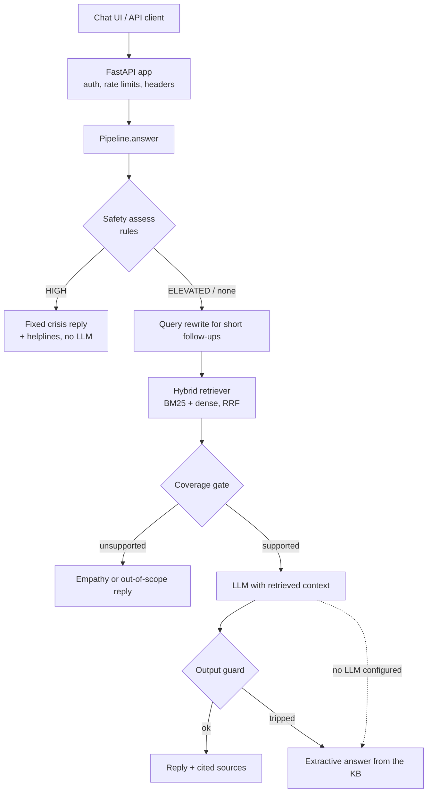

# Architecture

## Modules

| module | role |
|---|---|
| `kb.py` | parse markdown docs with front matter, split into chunks of at most ~110 words |
| `bm25.py` | Okapi BM25 over a light stemmer, written from scratch |
| `embeddings.py` | `LsaEmbedder` (TF-IDF + SVD, offline) and `SbertEmbedder` (sentence-transformers) |
| `index.py` | `HybridRetriever`: BM25, dense, Reciprocal Rank Fusion, per-document chunk cap, coverage gate |
| `safety.py` | rule-based crisis detection, helplines, fixed crisis reply |
| `guard.py` | post-generation checks (medication, dosage, diagnosis, guarantees) and citation cleanup |
| `llm.py` | Anthropic, OpenAI-compatible and Ollama clients over httpx, with retry on 408/429/5xx |
| `pipeline.py` | ties the above together and picks a reply mode |
| `auth.py`, `sessions.py`, `api.py` | users, tokens, in-memory conversation store, HTTP layer |
| `evaluate.py` | retrieval, scope and crisis metrics |

## Reply modes

`crisis`, `grounded`, `empathy`, `smalltalk`, `out_of_scope`, `extractive`. The mode is
returned in every API response so a client (or a test) can see which path was taken.

## Retrieval

Chunks are indexed as title, topics, keywords, section heading and text. A query is scored
by BM25 and by cosine similarity in the embedding space. The two rankings are merged with
Reciprocal Rank Fusion (k=60), limited to a few chunks per document so one long document
cannot fill the context. Candidates come from a pool of 40.
